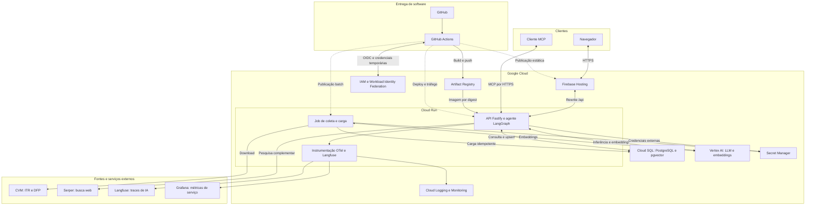
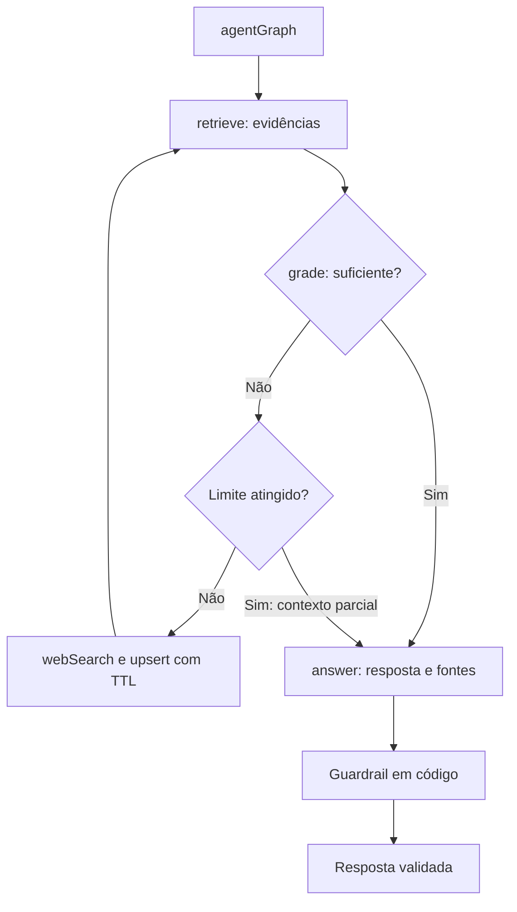
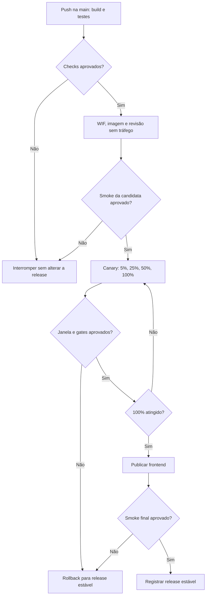

# AI Researcher — Capstone de Engenharia de Software com IA

> **Aviso regulatório:** este assistente apresenta informações públicas para fins educacionais e informativos. Não constitui recomendação de investimento nem orientação para comprar, vender ou manter ativos. As respostas devem identificar suas fontes e datas-base e indicar quando as evidências forem insuficientes.

**Status:** documentação inicial e arquitetura planejada. Este pacote contém o README, as fontes Mermaid e as imagens dos três diagramas. A aplicação, a infraestrutura e a esteira de deploy ainda precisam ser implementadas e verificadas no repositório de código.

## Visão geral

O AI Researcher é um assistente de pesquisa sobre empresas de capital aberto. Ele utiliza dados públicos da Comissão de Valores Mobiliários (CVM) e recuperação aumentada por geração (RAG) para produzir respostas fundamentadas em evidências.

O agente consulta primeiro sua base vetorial, avalia se o contexto responde à pergunta e, quando necessário, busca informações complementares na web. O processo tem limite de iterações, rastreabilidade das fontes e um filtro de saída implementado em código.

O projeto integra engenharia de dados, desenvolvimento de APIs, orquestração de agentes, testes automatizados, entrega contínua, observabilidade e controle de consumo de modelos.

### Comportamentos esperados

- Responder perguntas sobre indicadores financeiros com fonte, empresa, período e data-base.
- Consultar a web somente quando a avaliação do contexto apontar informação faltante.
- Reutilizar conteúdos da web enquanto estiverem dentro de seu prazo de validade.
- Explicitar contexto incompleto e falhas de serviços externos.
- Bloquear linguagem recomendatória por uma proteção em código, complementando as instruções dadas ao modelo.
- Exibir ao usuário as etapas executadas, as fontes e o resultado final.
- Disponibilizar a mesma capacidade para clientes MCP.

Exemplos de perguntas: “Qual foi a receita líquida da empresa no período?”, “Como evoluiu o lucro líquido?” e “Qual informação pública recente complementa estes resultados?”.

## Stack de referência

| Camada | Tecnologia | Papel |
| --- | --- | --- |
| Interface | Angular e TypeScript | Chat, fontes clicáveis e painel de execução. |
| API | Node.js, Fastify e TypeScript | Contratos HTTP, eventos SSE e acesso ao agente. |
| Orquestração | LangGraph e LangChain.js | Estado do agente, nós e transições condicionais. |
| Banco | PostgreSQL com pgvector | Indicadores, textos, metadados e busca por similaridade. |
| Modelos | Vertex AI | LLM e geração de embeddings. |
| Busca web | Serper | Pesquisa dos aspectos que faltam no contexto. |
| Execução | Cloud Run | Backend em contêiner e revisões de aplicação. |
| Hospedagem web | Firebase Hosting | Arquivos estáticos e encaminhamento de chamadas HTTP. |
| Imagens | Artifact Registry | Armazenamento de imagens identificadas por digest. |
| Banco gerenciado | Cloud SQL | PostgreSQL na nuvem. |
| Credenciais | IAM, Workload Identity Federation e Secret Manager | Identidades de execução, autenticação da esteira e segredos. |
| Telemetria | OpenTelemetry, Langfuse, Grafana e serviços de observabilidade do GCP | Traces, latência, erros, tokens e estimativa de custos. |
| Entrega | GitHub Actions | Verificações, publicação e promoção gradual. |

As versões da aplicação deverão ser fixadas no projeto-base e no lockfile. O modelo e a dimensão dos embeddings precisam ser compatíveis com o schema do banco; carga e consulta utilizarão o mesmo modelo.

## 1. Arquitetura de infraestrutura

O frontend será servido pelo Firebase Hosting. A API e o agente compartilharão o backend no Cloud Run. O Cloud SQL armazenará os dados do RAG, e o Vertex AI fornecerá inferência e embeddings. As chaves dos serviços externos ficarão no Secret Manager.

O job de carga representado abaixo é uma proposta para operacionalizar a ingestão em Cloud Run Jobs. No piloto, a coleta poderá rodar localmente. A periodicidade de execução será definida durante a implementação.



[Versão renderizada em SVG](docs/diagrams/infraestrutura.svg) · [Fonte Mermaid](docs/diagrams/infraestrutura.mmd)

### Responsabilidades e conexões

- **Cliente:** recebe somente respostas, fontes e eventos de execução; as credenciais de provedores permanecem no backend.
- **API:** coordena o agente, valida entradas e aplica limites de requisições e consumo.
- **Carga batch:** coleta, normaliza, valida e insere documentos com upsert. A carga inicial é separada do atendimento ao usuário.
- **Cloud SQL:** acesso configurado com identidade e conectividade apropriadas; banco local de desenvolvimento separado do banco na nuvem.
- **Vertex AI:** autenticação da aplicação por identidade de serviço, sem chave estática versionada.
- **Observabilidade:** traces e métricas devem carregar o identificador da requisição e da revisão publicada. Credenciais e dados sensíveis serão removidos antes da exportação.
- **MCP:** a ferramenta de consulta utiliza o mesmo agente e as mesmas proteções do chat. A política de acesso do endpoint deverá ser configurada antes da exposição pública.

### Roteamento HTTP e SSE

Os rewrites do Hosting e os caminhos implementados pela API deverão ser definidos juntos. O prefixo `/api` do diagrama representa esse contrato de publicação, não a existência de rotas já implementadas.

Para o canary, o caminho de produção precisa alcançar o serviço Cloud Run com sua distribuição normal de tráfego. A proposta usa rewrite sem fixação por `pinTag`; uma URL de revisão com tag será usada apenas nos smoke tests.

O Firebase Hosting documenta timeout de 60 segundos por requisição. O fluxo SSE deverá respeitar esse limite quando passar pelo Hosting. Para execuções mais longas, o frontend poderá chamar a URL normal do Cloud Run, com CORS restrito à origem da aplicação. A resposta de chat utilizará política de cache adequada para streaming.

## 2. Grafo do agente como RAG corretivo

O nó de entrada se chama **`agentGraph`**. Os nós recebem dependências por parâmetro para permitir testes com fakes, sem chamadas reais à LLM, ao provedor de busca ou ao banco durante os testes unitários.



[Versão renderizada em SVG](docs/diagrams/agente-rag-corretivo.svg) · [Fonte Mermaid](docs/diagrams/agente-rag-corretivo.mmd)

### Contrato de execução

| Etapa | Responsabilidade |
| --- | --- |
| `agentGraph` | Inicializar pergunta, documentos, contador e sinalizadores do estado. |
| `retrieve` | Gerar embedding da pergunta e recuperar documentos pertinentes e não expirados. |
| `grade` | Avaliar se o contexto responde à pergunta e produzir saída estruturada com o que falta. |
| Limite de iterações | Impedir ciclos indefinidos e consumo sem limite. |
| `webSearch` | Pesquisar aspectos faltantes, extrair texto, gerar embeddings e gravar conteúdos com fonte e TTL. |
| `answer` | Redigir com base nas evidências, indicar limitações e anexar fontes. |
| Filtro determinístico | Substituir uma saída recomendatória detectada por aviso de bloqueio, preservando as referências. |

O valor inicial de referência será `MAX_ITERATIONS = 2`, contando passagens por `grade`, não chamadas à web. O retorno de `webSearch` sempre passa novamente por `retrieve` e `grade`.

A configuração inicial da busca será top-k igual a 5. Conteúdos da web terão TTL configurável, com referência inicial de 7 dias, e registros expirados serão excluídos da recuperação. As demonstrações da CVM manterão seu período histórico e deverão ser atualizadas quando houver novas versões.

O filtro textual é uma proteção adicional, com testes para recomendações diretas, variações linguísticas e pedidos disfarçados. A cobertura e as limitações dessa proteção precisarão ser avaliadas antes do uso em produção.

Os eventos SSE representarão início, conclusão, duração e falha das etapas, além da resposta validada. Texto de saída ainda não aprovado pelo filtro não deve ser transmitido ao usuário.

## Dados utilizados

A fonte principal são os conjuntos públicos de **Informações Trimestrais (ITR)** e **Demonstrações Financeiras Padronizadas (DFP)** da CVM.

| Indicador | Demonstração de referência |
| --- | --- |
| Receita líquida | Demonstração do Resultado — DRE. |
| Lucro bruto, quando aplicável | DRE. |
| Lucro líquido | DRE. |
| Ativo total | Balanço Patrimonial — Ativo. |
| Patrimônio líquido | Balanço Patrimonial — Passivo. |
| Caixa operacional | Demonstração dos Fluxos de Caixa. |

O escopo das aulas contempla 20 empresas e os quatro últimos trimestres disponíveis. A lista deverá vir do CSV de empresas do projeto-base. Para validar a primeira carga, o piloto proposto contempla Vale, Petrobras e Klabin.

### Preparação e rastreabilidade

1. Baixar os arquivos da CVM e registrar origem, versão e data da coleta.
2. Interpretar os CSVs e selecionar empresas, contas e períodos.
3. Validar unidade monetária, período acumulado ou trimestral e demonstração individual ou consolidada.
4. Normalizar os indicadores e identificar campos indisponíveis sem convertê-los em zero.
5. Gerar parágrafos por templates determinísticos, sem usar LLM para inventar ou resumir números.
6. Gerar embeddings e carregar o banco com uma chave de negócio que permita reprocessamento sem duplicações.
7. Preservar ticker, código CVM, empresa, setor, período, data-base, fonte e data de coleta.

Informações vindas da web serão identificadas separadamente, com URL, título, data de coleta e expiração. Elas complementam a pesquisa e mantêm sua origem visível na resposta.

## 3. Pipeline de deploy canary

A esteira abaixo é a **proposta de publicação**. Ela deverá ser implementada no GitHub Actions. Os percentuais 5%, 25%, 50% e 100% são uma política inicial sugerida, sujeita à calibração.

Em pull requests, a esteira executará as verificações e encerrará sem publicar. O fluxo de deploy será acionado por push na `main`, após a aprovação das verificações.



[Versão renderizada em SVG](docs/diagrams/deploy-canary.svg) · [Fonte Mermaid](docs/diagrams/deploy-canary.mmd)

### Política de promoção

1. Executar build, lint, verificação de tipos e testes automatizados.
2. Autenticar o GitHub Actions no GCP por OIDC e Workload Identity Federation, com escopo restrito ao repositório e ao ambiente.
3. Construir a imagem, publicar no Artifact Registry e registrar seu digest e o commit de origem.
4. Capturar o identificador da revisão estável e publicar a candidata sem tráfego de produção.
5. Testar a candidata por sua URL com tag, verificando saúde, conexão com o banco e contratos HTTP.
6. Enviar 5% do tráfego à candidata e manter o restante na revisão estável.
7. Observar cada estágio e promover para 25%, 50% e 100% somente após seus gates.
8. Publicar o frontend compatível após a promoção do backend e executar a validação final.
9. Registrar a nova release estável ou restaurar a anterior diante de falha.

A distribuição percentual ocorre entre revisões do **backend no Cloud Run**. O frontend no Firebase Hosting terá publicação versionada e rollback próprio.

### Gates que precisam ser configurados

| Gate | Sinal de avaliação |
| --- | --- |
| Saúde | Aplicação e banco disponíveis, sem falhas críticas de contrato. |
| Confiabilidade | Taxa de erros, timeouts e falhas de SSE dentro do limite acordado. |
| Desempenho | Latência por revisão comparada ao baseline estável. |
| Consumo | Tokens e custo por requisição dentro do orçamento definido. |
| Qualidade do agente | Citações, tratamento de contexto insuficiente e proteções validados por testes. |
| Evidência operacional | Janela de observação e quantidade mínima de requisições satisfeitas. |

Os limites numéricos e a duração de observação serão estabelecidos após o baseline do ambiente. Ausência de dados suficientes não aprova automaticamente uma promoção; o estágio permanece bloqueado para avaliação.

### Rollback e compatibilidade

- Manter a revisão estável identificada explicitamente, sem depender de um alias para a revisão mais recente.
- Reencaminhar 100% do tráfego para a revisão estável quando um gate falhar.
- Se o frontend já tiver sido publicado, restaurar sua release anterior e verificar a compatibilidade.
- Registrar o resultado do rollback e executar um smoke test.
- Usar migrações de banco compatíveis com as duas revisões durante a convivência. Alterações destrutivas ficam fora do canary.
- Tratar a reversão de dados ou schema separadamente: mudar o tráfego não desfaz uma migração.
- Serializar deploys no mesmo ambiente para evitar promoções concorrentes.

No primeiro deploy ainda não existe uma revisão estável anterior. Nesse caso, os smoke tests e a validação controlada estabelecerão a primeira release de referência; o canary será usado nas atualizações seguintes.

## Qualidade, resiliência e operação

### Testes previstos

- **Unitários:** parsing da CVM, normalização, templates, filtros e transições do agente com fakes.
- **Integração:** migrations, upsert idempotente e recuperação no PostgreSQL com pgvector de teste.
- **Contratos:** formatos HTTP, eventos SSE e ferramenta MCP.
- **E2E:** pergunta, resposta, fonte clicável, painel de execução e aviso regulatório, usando modo demo.
- **Smoke:** saúde e contratos da revisão candidata.
- **Avaliação do agente:** conjunto de perguntas com fontes esperadas e casos de contexto insuficiente.

### Controles previstos

Timeout, retry com backoff e circuit breaker protegerão chamadas externas. Falhas na busca poderão produzir uma resposta com contexto parcial explicitamente sinalizado.

Rate limiting e orçamento de tokens serão verificados antes de iniciar a resposta SSE. Um contador em memória atende ao laboratório de uma instância; um limite global em múltiplas instâncias e revisões precisará de estado compartilhado.

Prompts, respostas e telemetria terão política de minimização e retenção. As métricas de operação incluirão latência, erros, uso de web search, tokens e estimativa de custo, segmentadas por revisão para apoiar o canary.

## Organização do repositório

Os arquivos entregues nesta etapa são:

| Caminho | Conteúdo |
| --- | --- |
| `README.md` | Visão geral e os três diagramas em Mermaid. |
| `docs/diagrams/infraestrutura.mmd` e `.svg` | Fonte e imagem da infraestrutura. |
| `docs/diagrams/agente-rag-corretivo.mmd` e `.svg` | Fonte e imagem do agente. |
| `docs/diagrams/deploy-canary.mmd` e `.svg` | Fonte e imagem da esteira. |
| `docs/diagrams/mermaid-config.json` | Aparência usada na renderização. |

A estrutura da aplicação a implementar seguirá o projeto-base:

| Caminho planejado | Responsabilidade |
| --- | --- |
| `apps/api/` | API, SSE e exposição MCP. |
| `apps/web/` | Interface Angular. |
| `packages/agent/` | Grafo, prompts, acesso ao banco e provedores. |
| `packages/corpus/` | Coleta e preparação dos dados da CVM. |
| `packages/contracts/` | Contratos compartilhados e validação. |
| `specs/` | Especificação, plano e tarefas do desenvolvimento. |
| `.github/workflows/` | Verificações e publicação canary. |

## Como começar a implementação

1. Usar o [AI Researcher Seed](https://github.com/unipds-engenharia-de-ia-aplicada/ai-researcher-seed) como ponto de partida e revisar o manifesto, o lockfile e as instruções do repositório.
2. Registrar escopo e critérios de aceite em `specs/spec.md`, decisões em `specs/plan.md` e tarefas em `specs/tasks.md`.
3. Preparar Git, Node.js/pnpm nas versões do projeto-base, Docker e o editor.
4. Subir o PostgreSQL com pgvector e implementar um health check que consulte o banco de verdade.
5. Implementar a carga piloto e seus testes de qualidade.
6. Conectar a recuperação vetorial, depois a avaliação, o fallback web e a resposta com fontes.
7. Acrescentar interface, MCP, observabilidade, orçamento e deploy gradual.

Os comandos de execução da aplicação serão documentados quando os pacotes e scripts correspondentes existirem. Este pacote de documentação não provisiona serviços nem publica a aplicação.

## Renderização e validação dos diagramas

Os blocos Mermaid deste README e os arquivos `.mmd` correspondentes devem permanecer idênticos.

A ferramenta de referência é **`@mermaid-js/mermaid-cli@12.0.0`**. Com Node.js e npm disponíveis, execute na raiz do projeto, em PowerShell:

```powershell
$diagramas = @("infraestrutura", "agente-rag-corretivo", "deploy-canary")

foreach ($diagrama in $diagramas) {
    npx --yes --package=@mermaid-js/mermaid-cli@12.0.0 mmdc -i "docs/diagrams/$diagrama.mmd" -o "docs/diagrams/$diagrama.svg" -c docs/diagrams/mermaid-config.json -b white
    if ($LASTEXITCODE -ne 0) {
        throw "Falha ao renderizar $diagrama"
    }
}
```

O primeiro uso poderá baixar a CLI e o navegador necessário à renderização. Em ambientes que já possuem Chromium, a opção `--puppeteerConfigFile` permite informar a configuração local; caminhos específicos da máquina não devem ser versionados.

Validação desta entrega:

- [x] Três blocos Mermaid correspondentes às três fontes `.mmd`.
- [x] Três arquivos SVG produzidos com sucesso pela CLI.
- [x] Imagens inspecionadas visualmente.
- [x] Nó de entrada do agente identificado como `agentGraph`.

## Roadmap

- [x] Definição da arquitetura de referência e documentação inicial.
- [ ] Importação e revisão do projeto-base.
- [ ] Especificação e critérios de aceite.
- [ ] Aplicação local conectada ao PostgreSQL.
- [ ] Carga CVM validada.
- [ ] RAG corretivo e busca complementar.
- [ ] Interface, fontes e MCP.
- [ ] Testes automatizados e avaliação do agente.
- [ ] Observabilidade e limites de consumo.
- [ ] Deploy canary e rollback exercitados.

## Custos e encerramento do laboratório

Configurar limites de instâncias, orçamento de tokens e alertas de faturamento. Alertas ajudam a acompanhar o gasto; o bloqueio de consumo precisa ser implementado na aplicação ou na infraestrutura.

Ao encerrar o laboratório, revisar os recursos provisionados e remover os que não forem mais necessários. Preservar os dados e registros exigidos antes de desativar o ambiente.

## Referências

- [Projeto-base AI Researcher Seed](https://github.com/unipds-engenharia-de-ia-aplicada/ai-researcher-seed).
- [Projeto completo da disciplina](https://github.com/unipds-engenharia-de-ia-aplicada/capstone-project-ai-researcher).
- Material da disciplina UNIPDS — Projeto Integrador / Capstone Project.
- [CVM — Informações Trimestrais](https://dados.cvm.gov.br/dataset/cia_aberta-doc-itr).
- [CVM — Demonstrações Financeiras Padronizadas](https://dados.cvm.gov.br/dataset/cia_aberta-doc-dfp).
- [Cloud Run — Rollbacks e distribuição gradual de tráfego](https://docs.cloud.google.com/run/docs/rollouts-rollbacks-traffic-migration).
- [Firebase Hosting — Integração com Cloud Run](https://firebase.google.com/docs/hosting/cloud-run).
- [Google Cloud — Workload Identity Federation para pipelines](https://docs.cloud.google.com/iam/docs/workload-identity-federation-with-deployment-pipelines).
- [Mermaid CLI — Documentação oficial](https://github.com/mermaid-js/mermaid-cli).

**Autor:** Fabio Estevam de Camargo Costa. A licença do repositório deverá ser definida antes da publicação, preservando as licenças de código e dependências reutilizados.
