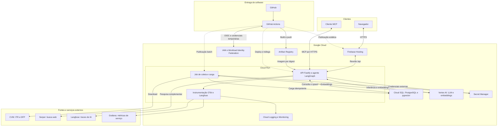
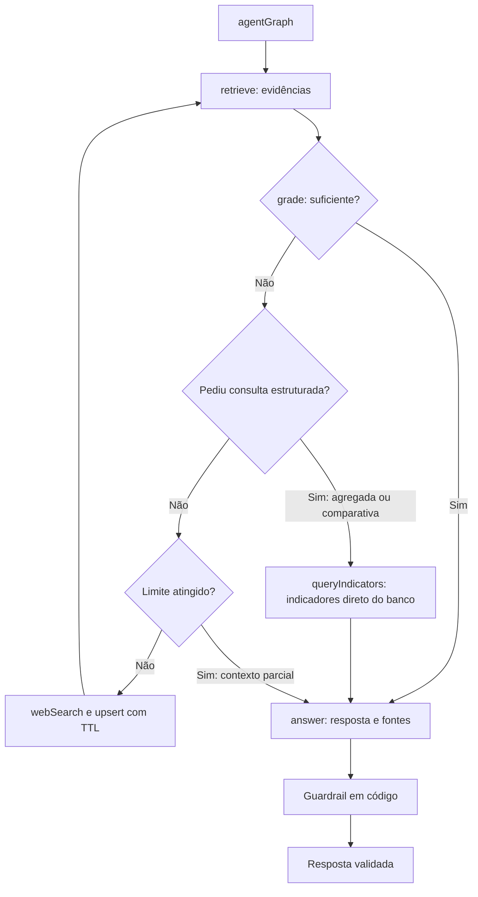
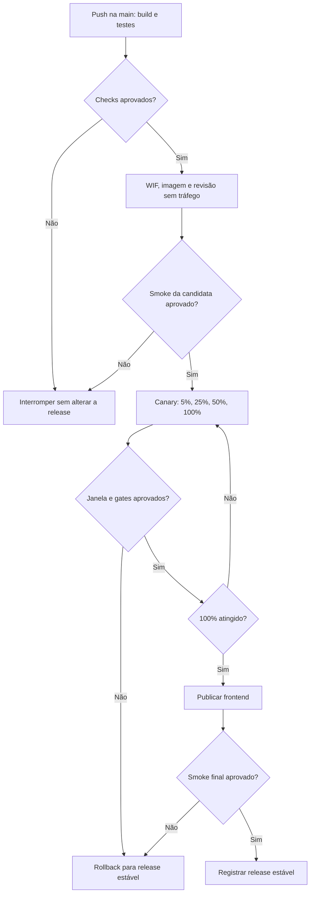

# AI Researcher — Capstone de Engenharia de Software com IA

> **Aviso regulatório:** este assistente apresenta informações públicas para fins educacionais e informativos. Não constitui recomendação de investimento nem orientação para comprar, vender ou manter ativos. As respostas devem identificar suas fontes e datas-base e indicar quando as evidências forem insuficientes.

**Status:** em produção em <https://ai-researcher-fabio.web.app> (Cloud Run + Firebase Hosting + Cloud SQL), com deploy canary e rollback exercitado. O `capstone:check` passa em 10 de 12 itens; faltam os traces no Langfuse (conta e chaves) e o vídeo do showcase. O andamento detalhado está em [`specs/tasks.md`](specs/tasks.md).

## Visão geral

O AI Researcher é um assistente de pesquisa sobre empresas de capital aberto. Ele utiliza dados públicos da Comissão de Valores Mobiliários (CVM) e recuperação aumentada por geração (RAG) para produzir respostas fundamentadas em evidências.

O agente consulta primeiro sua base vetorial, avalia se o contexto responde à pergunta e, quando necessário, busca informações complementares na web. O processo tem limite de iterações, rastreabilidade das fontes e um filtro de saída implementado em código.

O projeto integra engenharia de dados, desenvolvimento de APIs, orquestração de agentes, testes automatizados, entrega contínua, observabilidade e controle de consumo de modelos.

### Comportamentos esperados

- Responder perguntas sobre indicadores financeiros com fonte, empresa, período e data-base.
- Consultar a web somente quando a avaliação do contexto apontar informação faltante.
- Reutilizar conteúdos da web enquanto estiverem dentro de seu prazo de validade.
- Explicitar contexto incompleto e falhas de serviços externos.
- Bloquear linguagem recomendatória por uma proteção em código, complementando as instruções dadas ao modelo.
- Exibir ao usuário as etapas executadas, as fontes e o resultado final.
- Disponibilizar a mesma capacidade para clientes MCP.

Exemplos de perguntas: “Qual foi a receita líquida da empresa no período?”, “Como evoluiu o lucro líquido?” e “Qual informação pública recente complementa estes resultados?”.

## Stack de referência

| Camada | Tecnologia | Papel |
| --- | --- | --- |
| Interface | Angular e TypeScript | Chat, fontes clicáveis e painel de execução. |
| API | Node.js, Fastify e TypeScript | Contratos HTTP, eventos SSE e acesso ao agente. |
| Orquestração | LangGraph e LangChain.js | Estado do agente, nós e transições condicionais. |
| Banco | PostgreSQL com pgvector | Indicadores, textos, metadados e busca por similaridade. |
| Modelos | Vertex AI | LLM e geração de embeddings. |
| Busca web | Serper | Pesquisa dos aspectos que faltam no contexto. |
| Execução | Cloud Run | Backend em contêiner e revisões de aplicação. |
| Hospedagem web | Firebase Hosting | Arquivos estáticos e encaminhamento de chamadas HTTP. |
| Imagens | Artifact Registry | Armazenamento de imagens identificadas por digest. |
| Banco gerenciado | Cloud SQL | PostgreSQL na nuvem. |
| Credenciais | IAM, Workload Identity Federation e Secret Manager | Identidades de execução, autenticação da esteira e segredos. |
| Telemetria | OpenTelemetry, Langfuse, Grafana e serviços de observabilidade do GCP | Traces, latência, erros, tokens e estimativa de custos. |
| Entrega | GitHub Actions | Verificações, publicação e promoção gradual. |

As versões da aplicação deverão ser fixadas no projeto-base e no lockfile. O modelo e a dimensão dos embeddings precisam ser compatíveis com o schema do banco; carga e consulta utilizarão o mesmo modelo.

## 1. Arquitetura de infraestrutura

O frontend será servido pelo Firebase Hosting. A API e o agente compartilharão o backend no Cloud Run. O Cloud SQL armazenará os dados do RAG, e o Vertex AI fornecerá inferência e embeddings. As chaves dos serviços externos ficarão no Secret Manager.

O job de carga representado abaixo é uma proposta para operacionalizar a ingestão em Cloud Run Jobs. No piloto, a coleta poderá rodar localmente. A periodicidade de execução será definida durante a implementação.




### Responsabilidades e conexões

- **Cliente:** recebe somente respostas, fontes e eventos de execução; as credenciais de provedores permanecem no backend.
- **API:** coordena o agente, valida entradas e aplica limites de requisições e consumo.
- **Carga batch:** coleta, normaliza, valida e insere documentos com upsert. A carga inicial é separada do atendimento ao usuário.
- **Cloud SQL:** acesso configurado com identidade e conectividade apropriadas; banco local de desenvolvimento separado do banco na nuvem.
- **Vertex AI:** autenticação da aplicação por identidade de serviço, sem chave estática versionada.
- **Observabilidade:** traces e métricas devem carregar o identificador da requisição e da revisão publicada. Credenciais e dados sensíveis serão removidos antes da exportação.
- **MCP:** a ferramenta de consulta utiliza o mesmo agente e as mesmas proteções do chat. A política de acesso do endpoint deverá ser configurada antes da exposição pública.

### Roteamento HTTP e SSE

Os rewrites do Hosting e os caminhos implementados pela API deverão ser definidos juntos. O prefixo `/api` do diagrama representa esse contrato de publicação, não a existência de rotas já implementadas.

Para o canary, o caminho de produção precisa alcançar o serviço Cloud Run com sua distribuição normal de tráfego. A proposta usa rewrite sem fixação por `pinTag`; uma URL de revisão com tag será usada apenas nos smoke tests.

O Firebase Hosting documenta timeout de 60 segundos por requisição. O fluxo SSE deverá respeitar esse limite quando passar pelo Hosting. Para execuções mais longas, o frontend poderá chamar a URL normal do Cloud Run, com CORS restrito à origem da aplicação. A resposta de chat utilizará política de cache adequada para streaming.

## 2. Grafo do agente como RAG corretivo

O nó de entrada se chama **`agentGraph`**. Os nós recebem dependências por parâmetro para permitir testes com fakes, sem chamadas reais à LLM, ao provedor de busca ou ao banco durante os testes unitários.




### Contrato de execução

| Etapa | Responsabilidade |
| --- | --- |
| `agentGraph` | Inicializar pergunta, documentos, contador e sinalizadores do estado. |
| `retrieve` | Gerar embedding da pergunta e recuperar documentos pertinentes e não expirados. |
| `grade` | Avaliar se o contexto responde à pergunta e produzir saída estruturada com o que falta. |
| Limite de iterações | Impedir ciclos indefinidos e consumo sem limite. |
| `webSearch` | Pesquisar aspectos faltantes, extrair texto, gerar embeddings e gravar conteúdos com fonte e TTL. |
| `answer` | Redigir com base nas evidências, indicar limitações e anexar fontes. |
| Filtro determinístico | Substituir uma saída recomendatória detectada por aviso de bloqueio, preservando as referências. |

O valor inicial de referência será `MAX_ITERATIONS = 2`, contando passagens por `grade`, não chamadas à web. O retorno de `webSearch` sempre passa novamente por `retrieve` e `grade`.

A configuração inicial da busca será top-k igual a 5. Conteúdos da web terão TTL configurável, com referência inicial de 7 dias, e registros expirados serão excluídos da recuperação. As demonstrações da CVM manterão seu período histórico e deverão ser atualizadas quando houver novas versões.

O filtro textual é uma proteção adicional, com testes para recomendações diretas, variações linguísticas e pedidos disfarçados. A cobertura e as limitações dessa proteção precisarão ser avaliadas antes do uso em produção.

Os eventos SSE representarão início, conclusão, duração e falha das etapas, além da resposta validada. Texto de saída ainda não aprovado pelo filtro não deve ser transmitido ao usuário.

## Dados utilizados

A fonte principal são os conjuntos públicos de **Informações Trimestrais (ITR)** e **Demonstrações Financeiras Padronizadas (DFP)** da CVM.

| Indicador | Demonstração de referência |
| --- | --- |
| Receita líquida | Demonstração do Resultado — DRE. |
| Lucro bruto, quando aplicável | DRE. |
| Lucro líquido | DRE. |
| Ativo total | Balanço Patrimonial — Ativo. |
| Patrimônio líquido | Balanço Patrimonial — Passivo. |
| Caixa operacional | Demonstração dos Fluxos de Caixa. |

O escopo das aulas contempla 20 empresas e os quatro últimos trimestres disponíveis. A lista deverá vir do CSV de empresas do projeto-base. Para validar a primeira carga, o piloto proposto contempla Vale, Petrobras e Klabin.

### Preparação e rastreabilidade

1. Baixar os arquivos da CVM e registrar origem, versão e data da coleta.
2. Interpretar os CSVs e selecionar empresas, contas e períodos.
3. Validar unidade monetária, período acumulado ou trimestral e demonstração individual ou consolidada.
4. Normalizar os indicadores e identificar campos indisponíveis sem convertê-los em zero.
5. Gerar parágrafos por templates determinísticos, sem usar LLM para inventar ou resumir números.
6. Gerar embeddings e carregar o banco com uma chave de negócio que permita reprocessamento sem duplicações.
7. Preservar ticker, código CVM, empresa, setor, período, data-base, fonte e data de coleta.

Informações vindas da web serão identificadas separadamente, com URL, título, data de coleta e expiração. Elas complementam a pesquisa e mantêm sua origem visível na resposta.

## 3. Pipeline de deploy canary

A esteira abaixo é a **proposta de publicação**. Ela deverá ser implementada no GitHub Actions. Os percentuais 5%, 25%, 50% e 100% são uma política inicial sugerida, sujeita à calibração.

Em pull requests, a esteira executará as verificações e encerrará sem publicar. O fluxo de deploy será acionado por push na `main`, após a aprovação das verificações.




### Política de promoção

1. Executar build, lint, verificação de tipos e testes automatizados.
2. Autenticar o GitHub Actions no GCP por OIDC e Workload Identity Federation, com escopo restrito ao repositório e ao ambiente.
3. Construir a imagem, publicar no Artifact Registry e registrar seu digest e o commit de origem.
4. Capturar o identificador da revisão estável e publicar a candidata sem tráfego de produção.
5. Testar a candidata por sua URL com tag, verificando saúde, conexão com o banco e contratos HTTP.
6. Enviar 5% do tráfego à candidata e manter o restante na revisão estável.
7. Observar cada estágio e promover para 25%, 50% e 100% somente após seus gates.
8. Publicar o frontend compatível após a promoção do backend e executar a validação final.
9. Registrar a nova release estável ou restaurar a anterior diante de falha.

A distribuição percentual ocorre entre revisões do **backend no Cloud Run**. O frontend no Firebase Hosting terá publicação versionada e rollback próprio.

### Gates que precisam ser configurados

| Gate | Sinal de avaliação |
| --- | --- |
| Saúde | Aplicação e banco disponíveis, sem falhas críticas de contrato. |
| Confiabilidade | Taxa de erros, timeouts e falhas de SSE dentro do limite acordado. |
| Desempenho | Latência por revisão comparada ao baseline estável. |
| Consumo | Tokens e custo por requisição dentro do orçamento definido. |
| Qualidade do agente | Citações, tratamento de contexto insuficiente e proteções validados por testes. |
| Evidência operacional | Janela de observação e quantidade mínima de requisições satisfeitas. |

Os limites numéricos e a duração de observação serão estabelecidos após o baseline do ambiente. Ausência de dados suficientes não aprova automaticamente uma promoção; o estágio permanece bloqueado para avaliação.

### Rollback e compatibilidade

- Manter a revisão estável identificada explicitamente, sem depender de um alias para a revisão mais recente.
- Reencaminhar 100% do tráfego para a revisão estável quando um gate falhar.
- Se o frontend já tiver sido publicado, restaurar sua release anterior e verificar a compatibilidade.
- Registrar o resultado do rollback e executar um smoke test.
- Usar migrações de banco compatíveis com as duas revisões durante a convivência. Alterações destrutivas ficam fora do canary.
- Tratar a reversão de dados ou schema separadamente: mudar o tráfego não desfaz uma migração.
- Serializar deploys no mesmo ambiente para evitar promoções concorrentes.

No primeiro deploy ainda não existe uma revisão estável anterior. Nesse caso, os smoke tests e a validação controlada estabelecerão a primeira release de referência; o canary será usado nas atualizações seguintes.

## Qualidade, resiliência e operação

### Testes

- **Unitários (Vitest, sem rede):** normalização da CVM, templates, filtros do guardrail, chunker, parser SSE, nós e grafo com LLM fake, rotas com `app.inject()`, servidor MCP com `InMemoryTransport`, stores e componentes Angular. Um teste de guardrail é obrigatório e não pode ser removido.
- **E2E (Playwright):** pergunta, resposta com "R$ 56,7 bilhões", citação com data-base, painel em 3 etapas e aviso regulatório, com a API em `DEMO=true`. Roda no CI a cada push.
- **Smoke e gates:** health e contratos da revisão candidata, a cada deploy canary.
- **Avaliação do agente:** `pnpm eval` faz as 27 perguntas de `evals/dataset.json` contra a API e grava o resultado em `evals/resultados/`.

### Controles

- Timeout de 10 s, retry com backoff exponencial e circuit breaker na busca web; se ela falhar, a resposta sai com contexto parcial sinalizado.
- Rate limit global (`RATE_LIMIT_MAX` por `RATE_LIMIT_WINDOW`, padrão 10 por minuto) e orçamento diário de tokens (`DAILY_TOKEN_BUDGET`, padrão 300 mil), ambos com 429 em `application/problem+json` antes do primeiro byte SSE. Os contadores ficam em memória: valem por instância do Cloud Run.
- Alerta no Cloud Monitoring quando há mais de 20 respostas 429 em 5 minutos.
- `GET /api/metrics` expõe `llm_tokens_total`, `llm_cost_usd_total` e `chat_perguntas_total` (custo médio por pergunta). A tabela de preços está em `apps/api/src/metricas.ts` e deve ser conferida na página oficial do Vertex AI.
- Langfuse opcional: com `LANGFUSE_PUBLIC_KEY` e `LANGFUSE_SECRET_KEY`, cada pergunta vira um trace com modelo, tokens e custo; sem as chaves, nada é enviado.
- O gateway MCP em `/api/mcp` fica desligado em produção (`MCP_GATEWAY=true` liga); o MCP fica no stdio e no servidor standalone local.

### Avaliação mais recente

Em 2026-10-26, com as 31 perguntas do dataset ([detalhes](evals/resultados/2026-10-26.md)): grupo A (dados do corpus) 12 de 12; grupo B (fallback web) 5 corretas e 3 parciais, em que a busca não trouxe o conteúdo e a resposta diz isso; grupo C (pedidos de recomendação) 7 de 7 recusadas; grupo D (agregadas e comparativas) 4 de 4. Nenhuma resposta recomendou nem inventou número.

### Consulta estruturada

Perguntas que pedem um indicador de várias empresas ou trimestres (ranking, "todas as empresas", comparação) não cabem no top-5 do retrieve. Nesses casos o `grade` devolve um pedido `consulta` (indicadores, tickers, períodos) e a aresta leva ao nó `queryIndicators`, que lê as colunas de indicadores direto no Postgres e vai ao `answer` sem passar pela web. O painel mostra a etapa como "consulta · indicadores".

### Limitações conhecidas

- Para empresas fora do corpus, a resposta avisa e usa só páginas da web; a página mais recente nem sempre é a que a busca traz.
- A consulta estruturada depende de o `grade` reconhecer a pergunta como agregada; uma formulação muito indireta pode seguir pelo caminho comum, com resposta parcial.
- Com busca web, a resposta pode passar de 45 s; o Firebase Hosting corta em 60 s.

## Organização do repositório

| Caminho | Responsabilidade |
| --- | --- |
| `apps/api/` | Fastify: `/api/health`, `/api/chat` (SSE), `/api/metrics`, gateway `/api/mcp`, erros em problem+json, rate limit e orçamento. |
| `apps/web/` | Angular 22: chat, citações, painel do pipeline, disclaimer; E2E em `e2e/`. |
| `packages/agent/` | Grafo LangGraph, nós, prompts, guardrail, banco (Drizzle + pgvector), busca web, modo demo e telemetria. |
| `packages/mcp-server/` | Tool `perguntar` via stdio e Streamable HTTP. |
| `packages/contracts/` | Schemas zod compartilhados (chat, eventos SSE, health, problem). |
| `packages/corpus/` | Coleta e normalização da CVM; os 80 documentos versionados. |
| `evals/` | Dataset de 27 perguntas, runner e resultados. |
| `scripts/` | `capstone-check.ts` e `canary.sh`. |
| `specs/` | Especificação, plano e tarefas (Spec Driven Development). |
| `docs/` | Plano do curso e protótipo da interface. |
| `.github/workflows/` | Testes, lint e E2E; deploy canary da API e do frontend. |

## Como rodar

Pré-requisitos: Node.js 24, pnpm 11, Docker e, para usar o Vertex AI localmente, `gcloud auth application-default login`. Copie `.env.example` para `.env` e preencha.

```bash
pnpm install
docker compose up -d postgres   # Postgres + pgvector local
pnpm db:migrate                 # cria as tabelas
pnpm seed                       # gera embeddings e grava os 80 documentos (idempotente)
pnpm dev                        # API em :3000 e web em :4200 (proxy /api)

pnpm test                       # unitários (sem rede)
pnpm test:e2e                   # Playwright com a API em DEMO=true
pnpm lint                       # ESLint + Prettier
pnpm eval --url http://127.0.0.1:3000             # avaliação com as 27 perguntas
pnpm capstone:check --url https://ai-researcher-fabio.web.app --project ai-researcher-fabio
```

`DEMO=true` troca o grafo inteiro por peças sem rede (sem banco, Vertex AI nem Serper): útil para gravar aula e para o E2E. O seed nunca roda em modo demo.

Para usar como ferramenta MCP no Claude Code, depois de `pnpm build`:

```bash
claude mcp add ai-researcher -- node --env-file=<repo>/.env <repo>/packages/mcp-server/dist/stdio.js
```

O deploy é automático: push na `main` roda testes, lint e E2E e publica a API por canary (5 → 25 → 50 → 100%, com rollback automático) e depois o frontend. A `main` exige o job `test`.

## Diagramas

Os três diagramas (infraestrutura, agente e deploy canary) existem só neste README, em blocos Mermaid que o GitHub renderiza. Uma fonte única: quando o grafo ou a esteira mudam, o bloco daqui é o único a atualizar. O nó de entrada do agente é `agentGraph`.

Para gerar uma imagem (slides, vídeo), copie o bloco para um arquivo `.mmd` e renderize com a [Mermaid CLI](https://github.com/mermaid-js/mermaid-cli):

```bash
npx --yes --package=@mermaid-js/mermaid-cli@12.0.0 mmdc -i agente.mmd -o agente.svg -b white
```

O primeiro uso baixa a CLI e o navegador que ela usa para renderizar. A imagem gerada não é versionada.

## Roadmap

- [x] Definição da arquitetura de referência e documentação inicial.
- [x] Importação e revisão do projeto-base.
- [x] Especificação e critérios de aceite (`specs/`).
- [x] Aplicação local conectada ao PostgreSQL.
- [x] Carga CVM validada (80 documentos, seed idempotente).
- [x] RAG corretivo e busca complementar.
- [x] Interface, fontes e MCP.
- [x] Testes automatizados e avaliação do agente.
- [x] Limites de consumo e métricas de custo.
- [ ] Traces no Langfuse (aguarda conta e chaves).
- [x] Deploy canary e rollback exercitados.
- [ ] Vídeo do showcase.
- [x] Consulta estruturada para perguntas agregadas e comparativas (T103).

## Custos e encerramento do laboratório

Configurar limites de instâncias, orçamento de tokens e alertas de faturamento. Alertas ajudam a acompanhar o gasto; o bloqueio de consumo precisa ser implementado na aplicação ou na infraestrutura.

Ao encerrar o laboratório, revisar os recursos provisionados e remover os que não forem mais necessários. Preservar os dados e registros exigidos antes de desativar o ambiente.

## Referências

- [Projeto-base AI Researcher Seed](https://github.com/unipds-engenharia-de-ia-aplicada/ai-researcher-seed).
- [Projeto completo da disciplina](https://github.com/unipds-engenharia-de-ia-aplicada/capstone-project-ai-researcher).
- Material da disciplina UNIPDS — Projeto Integrador / Capstone Project.
- [CVM — Informações Trimestrais](https://dados.cvm.gov.br/dataset/cia_aberta-doc-itr).
- [CVM — Demonstrações Financeiras Padronizadas](https://dados.cvm.gov.br/dataset/cia_aberta-doc-dfp).
- [Cloud Run — Rollbacks e distribuição gradual de tráfego](https://docs.cloud.google.com/run/docs/rollouts-rollbacks-traffic-migration).
- [Firebase Hosting — Integração com Cloud Run](https://firebase.google.com/docs/hosting/cloud-run).
- [Google Cloud — Workload Identity Federation para pipelines](https://docs.cloud.google.com/iam/docs/workload-identity-federation-with-deployment-pipelines).
- [Mermaid CLI — Documentação oficial](https://github.com/mermaid-js/mermaid-cli).

**Autor:** Fabio Estevam de Camargo Costa. A licença do repositório deverá ser definida antes da publicação, preservando as licenças de código e dependências reutilizados.
